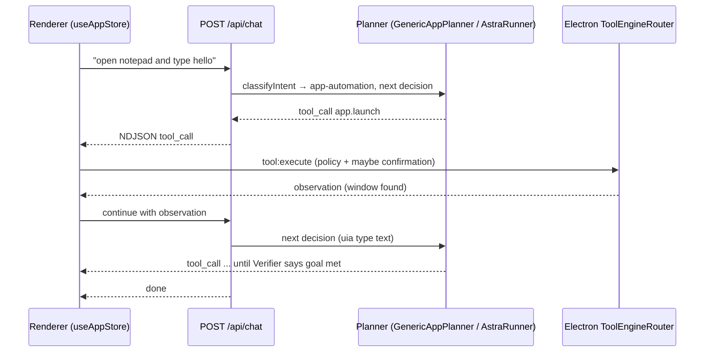

Desktop-automation agent that turns requests like "open Notepad and type…", "find the PDF in Downloads" or "install VLC" into a step-by-step sequence of typed tool calls (launch, inspect UI, click, type, browse, install), verifying each step before moving on.

**Status:** Implemented via the **chat route**. The standalone `POST /api/orchestrate` entry point (`AgentOrchestrator.runOrchestrator`) is implemented but has **no in-repo caller** from the renderer (only its `/checkpoints/*` sub-routes are used, for repair) — **unverified** as a user-facing path.

## Responsibilities
- Decision engines used by `routes/chat.js`: `orchestrator/GenericAppPlanner.js` (`nextDesktopDecision`), `AstraRunner.js` (`nextAstraDecision`), `SoftwareRunner.js` (`nextSoftwareDecision`), `ExplorerTask.js` (`nextExplorerDecision`); task shapes in `AppLaunchTask.js`, `BrowserTask.js`, `CalculatorTask.js`, `GenericDesktopTask.js`, `FreeformDesktopTask.js`
- Policy and verification shared with the renderer: `ComputerTaskPolicy.js` (`computerTask`, `compoundAppTask`), `CapabilityContracts.js` (`verifyCapabilities`), `ApplicationGoal.js`, `Verifier.js`, `ElementResolver.js`, `InputPolicy.js`
- Streams `tool_call` NDJSON events; the renderer executes them through `window.toolEngine.execute` (IPC `tool:execute`) and sends the observation back — so in this path the desktop call goes **renderer → Electron**, not backend → bridge
- Handles disambiguation (`software_choice`, app-choice modal) and pending tasks (`PendingAppTask.js`)

## Chat-driven app control loop

## Tech Stack
- Node.js decision code shared between backend and renderer; Electron tool services (`AppService`, `UIAutomationService`, `GenericDesktopService`, `BrowserAutomationService`, `ExplorerToolService`, `SystemSettingsService`, `WingetService`, `SoftwareService`)
