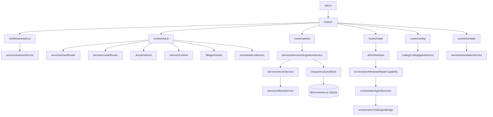

Loopback-only Express server that owns user accounts, chat routing, document indexing/RAG, memory, the coding agent and the repair/app-control orchestrators, and talks to Ollama, SQLite, LanceDB and the IndicTrans2 service.

**Status:** Implemented

## Responsibilities
- Startup (`backend/src/server.js`): open SQLite + run migrations, listen on `HOST:PORT` (default `127.0.0.1:3001`), print `CHANAKYA_BACKEND_READY {port,pid}` for Electron, start/health-check IndicTrans2, detect GPU/CPU profile
- Request pipeline (`backend/src/app.js`): desktop client-key check → helmet CSP → loopback host + local-origin allowlist (`middleware/localOrigin.js`) → CORS → JSON (10 MB) → routers; `askLimiter` on `/chat`, `/agent`, `/repair`, `/orchestrate`
- Serves the built SPA (`FRONTEND_DIST_PATH`) and OCR language data (`/ocr`)
- Owns all persistence: SQLite tables, per-user LanceDB, uploads under `APP_DATA_PATH/storage/`

## Backend module dependency map

## Tech Stack
- Node.js ESM, Express 4, helmet, cors, express-rate-limit, multer, better-sqlite3, @lancedb/lancedb, pdf-parse, mammoth, read-excel-file, dotenv
