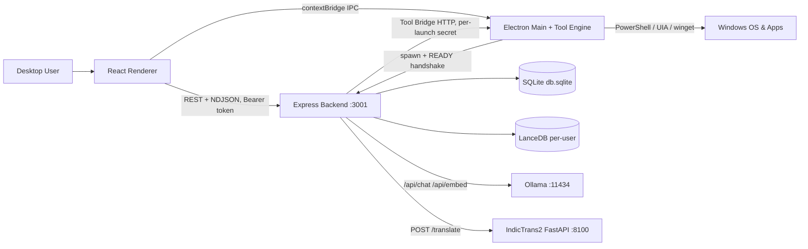

Local-first Windows desktop assistant that answers questions, searches the user's documents, writes code, translates Indic languages and operates Windows apps — with every model running on the user's own machine through Ollama and every system-changing action gated by explicit user approval.

**Status:** Implemented (desktop app, chat, RAG, coding agent, typed print-spooler repair, app control, translation). See each component for per-feature status.

## Responsibilities
- Host a React chat UI inside an Electron shell (`frontend/electron/main.js`), packaged as a Windows `.exe` via electron-builder (`appId: com.chanakya.ai`)
- Spawn and supervise the Express backend (`backend/src/server.js`) as a child process on `127.0.0.1`
- Route each user request to a logical agent (general chat, document intelligence, Windows repair, OS control, app automation, software install) and pick an installed local model for it
- Keep all user data local: SQLite (`storage/db.sqlite`), per-user LanceDB vectors, uploads, coding workspaces
- Enforce a policy layer for every desktop tool call (risk class, allowed scope, approval gate, audit ledger)

## Status legend used in these docs
- **Implemented** — code path exists and is wired end-to-end
- **Partially implemented** — code exists but a piece is missing, gated off, or narrower than its name suggests
- **Planned** — only described in `docs/`, no runtime code
- **Unverified** — code exists but no in-repo caller was found, or behaviour depends on runtime state that static reading can't confirm

## Overall architecture

## Tech Stack
- Electron 37, React 19, Vite 6, Tailwind, Zustand, three.js / react-three-fiber
- Node.js ≥ 20, Express 4, better-sqlite3, @lancedb/lancedb, multer, pdf-parse, mammoth, read-excel-file
- Python FastAPI + transformers 4.44.2 + IndicTransToolkit (optional translation pack)
- Ollama (external, user-installed) for all LLM and embedding inference
