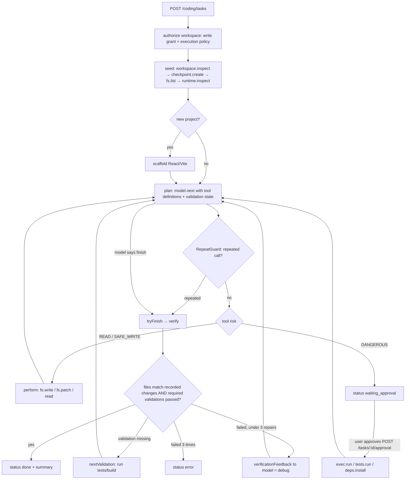

Local software-engineering agent that plans, edits, runs and verifies code inside a user-authorized workspace folder using a local Ollama coding model, and refuses to report success until required validations have actually passed on the current file contents.

**Status:** Implemented. Caveats:
- `git.status` / `git.diff` go through `CommandExecutionService`, which **fails closed** (`ISOLATION_UNAVAILABLE`) because no OS isolation provider is wired in production — effectively unavailable
- Remote/cloud Ollama models are rejected (`CodingModelAdapter.isRemoteModel`)

## Responsibilities
- Service: `backend/src/coding/CodingAgentService.js` (`start`, `drive`, `perform`, `dispatch`, `tryFinish`, `verify`, `approve`, `cancel`), persisted by `CodingTaskRepository.js` (`coding_tasks`, `coding_grants`, `coding_execution_grants`, `coding_tool_approvals`, `coding_audit`)
- Model: `CodingModelAdapter.js` (default `qwen2.5-coder:14b`, timeout `CODING_MODEL_TIMEOUT_SECONDS`), prompts from `CodingGuidance.js`, loop protection by `RepeatGuard.js`
- Tools (`contracts.js` → `CODING_TOOLS`, executed by `CodingToolEngine.js`): READ — `workspace.open/inspect`, `fs.list/read`, `code.search/symbols/diff`, `git.status/diff`, `runtime.inspect`, `exec.output`, `checkpoint.list`; SAFE_WRITE — `fs.mkdir/write/patch`, `exec.stop`, `checkpoint.create`; DANGEROUS (needs approval) — `fs.delete`, `exec.run`, `tests.run`, `exec.start`, `preview.start`, `deps.install`, `runtime.install`, `checkpoint.restore`
- File confinement: `WorkspaceFiles.js` + `WindowsWorkspaceGuard.cs` (hash-pinned C# helper via `Add-Type`); processes via `ProjectRuntime.js` → `WindowsProjectProcess.js` + `ProjectProcessHost.cs`; toolchains in `Toolchains.js` / `ToolchainCommands.js`; new projects in `NewProject.js` / `ProjectScaffold.js` (React + Vite scaffold); previews in `ProjectPreview.js`
- API: `/api/coding/*` (`routes/coding.js`); UI: `frontend/src/coding/CodingWorkspace.jsx`, `CodingPanel.jsx`, `RuntimePanel.jsx`

## Plan → edit → test → debug loop

## Tech Stack
- Node.js, Ollama (`/api/chat`), PowerShell + C# helpers for Windows confinement, SQLite
