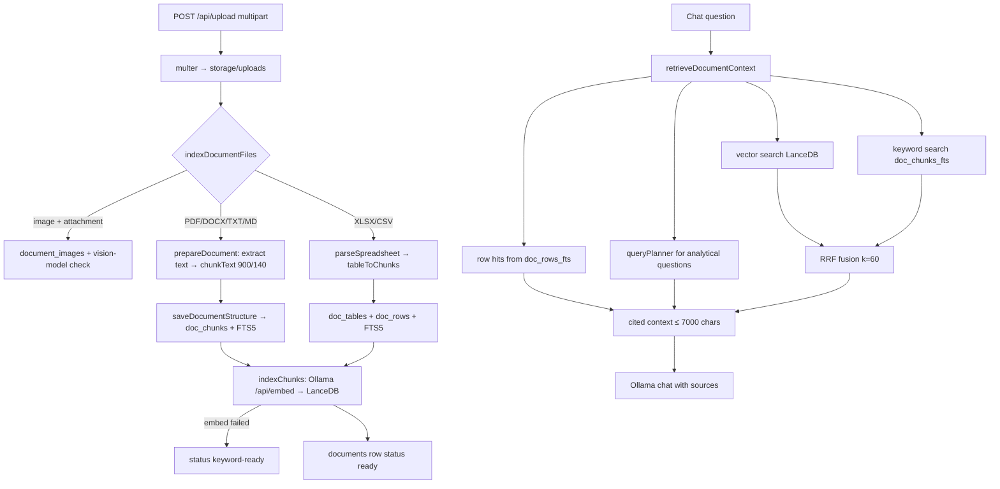

Turns uploaded or workspace files into searchable knowledge — parsed text chunks, structured spreadsheet rows and vector embeddings — and assembles a bounded, cited context for each question using hybrid keyword + vector retrieval and an exact-arithmetic table planner.

**Status:** Implemented. Reranking is **rank fusion only** (Reciprocal Rank Fusion, k = 60); there is no cross-encoder/LLM reranker. Scanned/image-only PDFs are rejected (no OCR at ingest).

## Responsibilities
- Ingest (`services/documentIngestionService.js` → `indexDocumentFiles`, `ingestWorkspaceFile`): bounded concurrency (`acquire`), sanitize name, accept PDF / DOCX / TXT / MD / CSV / XLSX (images only as chat attachments when a vision model is installed), validate MIME vs extension
- Parse (`docqa/ingest.js` → `prepareDocument`): PDF per page via pdf-parse (`[Page N]` prefixes), DOCX text + tables via mammoth, spreadsheets via `tableParser.js`; text split by `lib/chunkText.js` (900 chars, 140 overlap, max 2000 chunks)
- Store structure (`docqa/structuredStore.js` → `saveDocumentStructure`): `doc_tables`, `doc_rows` (+FTS5), `doc_chunks` (+FTS5) in SQLite
- Embed (`services/vectorService.js` → `indexChunks`) into per-user LanceDB; if Ollama embedding fails the document is saved as `keyword-ready` instead of `ready`
- Retrieve (`docqa/retrieve.js` → `retrieveDocumentContext`): scope to knowledge/attachment/workspace document ids, then (1) exact spreadsheet row hits, (2) `queryPlanner.answerWithPlanner` for analytical questions (model writes a plan, JavaScript computes the numbers), (3) vector + FTS keyword search fused with RRF, (4) small touched tables inlined in full — all within a 7,000-char budget (`DOCQA_CONTEXT_CHARS`)
- Tamil/Tanglish-aware stop-word list for keyword search

## Document upload → retrieval flow

## Tech Stack
- pdf-parse, mammoth, read-excel-file, SQLite FTS5, @lancedb/lancedb, Ollama embeddings
