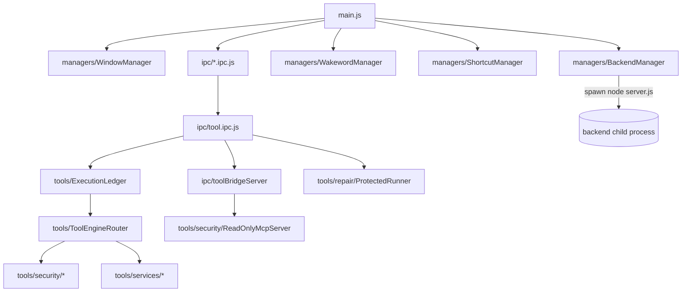

The Electron main process: owns the app window and OS integrations, launches the backend with per-launch secrets, and hosts the desktop Tool Engine that is the only component allowed to touch Windows (PowerShell, UI Automation, services, installers).

**Status:** Implemented

## Responsibilities
- Boot sequence in `frontend/electron/main.js`: GPU-safe mode + crash guard → register IPC handlers (window, system, workspace, capture, tool, auth) → start the internal Tool Bridge server → `BackendManager.startBackend(app, toolBridge)` → wait for health → create window → global shortcuts
- Preload (`frontend/electron/preload.cjs`) exposes `electronAPI`, `sessionAPI`, `workspaceAPI`, `softwareAPI`, `toolEngine` via `contextBridge`; handlers are wrapped in `requireTrustedSender` (`utils/ipcTrust.js`, only the main window's main frame)
- Holds the login token in memory only (`services/SessionStore.js`) — closing the app logs the user out
- Generates a random `CHANAKYA_CLIENT_SECRET` per launch so the backend rejects `Origin: null` API calls that don't carry it
- Packages `tools/apps/*.ps1` + `DesktopAccessibility.cs` as `resources/desktop-control` (electron-builder `extraResources`)
- In development, `frontend/dev-host/` recreates the same Tool Bridge + a browser-facing tool host for `npm run dev:tools`

## Module dependency map

## Tech Stack
- Electron 37, electron-builder 26, Node `child_process`, `say` (TTS), playwright-core (browser automation against installed Chromium browsers)
