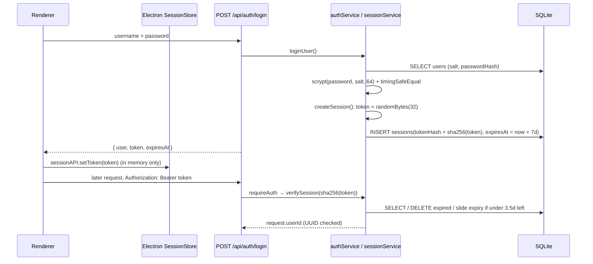

Express routers under `/api/*` plus the authentication middleware that turns a Bearer session token into a trusted `request.userId` for every downstream service.

**Status:** Implemented. **JWT is not used** — there is no `jsonwebtoken` dependency and no signed token anywhere. Auth uses opaque random session tokens stored as SHA-256 hashes in SQLite (details below).

## Responsibilities
- Mount 16 routers in `backend/src/app.js`: `auth`, `upload`, `chat`, `models`, `history`, `transcribe`, `documents`, `workspaces`, `coding`, `memory`, `stats`, `agent`, `repair`, `orchestrate`, `translate`, `file-agent`, plus `GET /api/health`
- `middleware/auth.js` → `requireAuth` (Bearer token → `verifySession`) and `requireAdmin` (re-reads `users.role` from DB; only `'Admin'` passes)
- `middleware/localOrigin.js` → loopback `Host` + allowed `Origin` (Vite dev origin, packaged `file://` with `X-Chanakya-Client` secret)
- `middleware/rateLimiter.js` → `askLimiter` on model-driving routes; auth routes add IP / login / register limiters and a progressive login delay
- Uniform error handler: 4xx `ValidationError` messages are echoed, everything else becomes `500 Unexpected local server error` with a request-id log line

## Authentication & session flow (actual implementation)

- Logout → `revokeSession(token)`; change password and password reset → `revokeAllSessionsForUser`
- Forgot password is **local only**: a reset code is written to `password-reset-token.txt` next to `db.sqlite` (hash stored in `password_resets`); there is no email delivery
- `users.permissions` column exists (default `'[]'`) but no code path enforces it — **unverified / unused**

## Route inventory (from `backend/src/routes/*.js`)
| Prefix | Endpoints |
|---|---|
| `/auth` | `POST /register /login /logout /change-password /forgot-password /reset-password` · `GET /me` · `PATCH /profile` · `DELETE /account` |
| `/chat` | `POST /` (NDJSON) |
| `/agent` | `POST /` (NDJSON; routes spooler goals to typed repair, all other goals are refused — see Windows Repair Agent) |
| `/repair` | `POST /` (NDJSON) · `POST /feedback` · `GET /sessions` + `GET /dataset` (Admin) |
| `/orchestrate` | `POST /` · `GET /checkpoints/:id` · `GET /checkpoints/:id/recovery` · `POST /checkpoints/:id/{reconcile,resume,cancel,confirmation/renew}` |
| `/coding` | `GET /models /tools /tasks /tasks/:id` · `POST /projects /tasks /tasks/:id/approval /tasks/:id/cancel` · `/workspaces/:id/{tree,file,runtime,execution-policy,authorize,tools,approvals/:approvalId,processes/:jobId/stop,processes/:jobId/open}` |
| `/upload` | `POST /` (multipart `documents[]`, ≤500 files, purpose `knowledge|attachment|workspace`) |
| `/documents` | `GET /` · `DELETE /:documentId` |
| `/workspaces` | `GET/POST /` · `POST /choose-directory` · `PATCH /:id` · `POST /:id/{activate,pause,index}` · `GET /:id/{files,status}` · `DELETE /:id/index` |
| `/memory` | `GET/POST/DELETE /` · `DELETE /:memoryId` · `GET/POST /long-term` · `PATCH/DELETE /long-term/:id` · `GET /tasks/:id` · `GET /short-term/:conversationId` · `POST /short-term/clear` · `GET /system` · `POST /system/refresh` |
| `/models` | `GET / /loaded` (open) · `GET/PUT /settings` · `GET /hardware /registry` · `POST /registry/refresh /unload` |
| `/history` | `GET / /search` · `PATCH/DELETE /:conversationId` · `POST /folders` · `PATCH/DELETE /folders/:folderId` |
| other | `POST /translate` · `POST /transcribe` · `GET /stats` · `/file-agent/outputs/:id` · `/file-agent/plans/:id[/apply|/undo]` |

## Tech Stack
- Express 4 Router, express-rate-limit, Node `crypto` (scrypt, randomBytes, sha256, timingSafeEqual)
