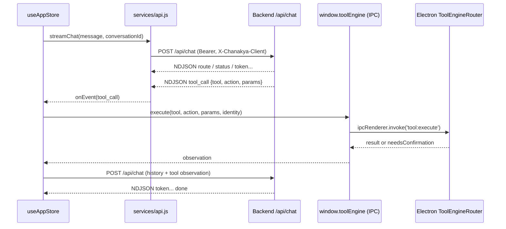

The React single-page UI that renders chat, coding, workspaces, translation and settings, streams model output from the backend, and executes model-proposed desktop tool calls through the Electron preload bridge.

**Status:** Implemented

## Responsibilities
- App shell and panels: `App.jsx`, `components/MainLayout.jsx`, `chat/ChatArea.jsx`, `coding/CodingWorkspace.jsx`, `workspace/WorkspaceHub.jsx`, `translator/TranslatorPanel.jsx`, `settings/SettingsPanel.jsx`, `memory/MemoryPanel.jsx`, `history/HistoryPanel.jsx`
- Central state + chat/tool loop in `stores/useAppStore.js` (Zustand): sends chat, consumes NDJSON events (`token`, `tool_call`, `route`, `sources`, `status`, `done`), runs each `tool_call` through `services/chatExecution.js` → `window.toolEngine.execute` and posts the observation back
- HTTP client `services/api.js`: axios instance with base URL from `electronAPI.getApiBaseUrl()`, adds `Authorization: Bearer <token>` and `X-Chanakya-Client` on every request; NDJSON streaming for `/chat`, `/repair`, `/agent`
- Session token lives in Electron main memory via `window.sessionAPI` (not `localStorage`)
- Local speech-to-text with Whisper (`Xenova/whisper-tiny.en`, transformers.js, `allowRemoteModels = false`) in `services/transcriber.js`, falling back to `POST /api/transcribe`
- Screen capture + OCR (`screen/ScreenRecorder.jsx`, `OcrCropModal.jsx`, tesseract.js with language data served from backend `/ocr`)
- Avatar: 2D photo by default (`components/ChanakyaAvatar.jsx`); 3D Ready-Player-Me style avatar (`widget/avatar3d/RpmAvatar.jsx`) only when the user drops `character.glb` into `public/avatar3d/` — **Partially implemented** (no model shipped; `ProceduralAvatar.jsx` kept but unused)
- Shares pure orchestration modules with the backend by importing `backend/src/orchestrator/*.js` directly (e.g. `ComputerTaskPolicy`, `ExecutionController`, `SoftwareRunner`)

## Frontend → backend data flow (chat with a desktop tool call)

## REST surface used by the renderer (from `services/api.js`)
| Area | Calls |
|---|---|
| Auth | `POST /auth/register, /login, /logout, /change-password, /forgot-password, /reset-password` · `GET /auth/me` · `PATCH /auth/profile` · `DELETE /auth/account` |
| Chat / agents | `POST /chat` (NDJSON) · `POST /repair` (NDJSON) · `POST /agent` (wrapper exists, **unverified** — no caller of `streamAgent`) · `POST /repair/feedback` |
| Docs & workspaces | `POST /upload` · `GET/DELETE /documents` · `GET/POST/PATCH /workspaces[...]` · `POST /workspaces/:id/index|pause|activate` |
| Coding | `GET /coding/models` · `POST /coding/projects` · `GET/POST /coding/tasks` · `POST /coding/tasks/:id/approval|cancel` · `GET /coding/workspaces/:id/tree|file|runtime` · `POST /coding/workspaces/:id/authorize|execution-policy` |
| Memory & history | `GET/POST/DELETE /memory` · `GET/POST/PATCH/DELETE /memory/long-term` · `GET/PATCH/DELETE /history` · folders |
| Other | `POST /translate` · `POST /transcribe` · `GET /models`, `/models/loaded` · `PUT /models/settings` · `POST /models/unload` · `GET /stats` · `/file-agent/*` · `/orchestrate/checkpoints/*` |

## Tech Stack
- React 19, Vite 6, Tailwind 3, Zustand 5, framer-motion, react-markdown, axios
- three.js + @react-three/fiber/drei (3D avatar), tesseract.js (OCR), @huggingface/transformers (Whisper)
