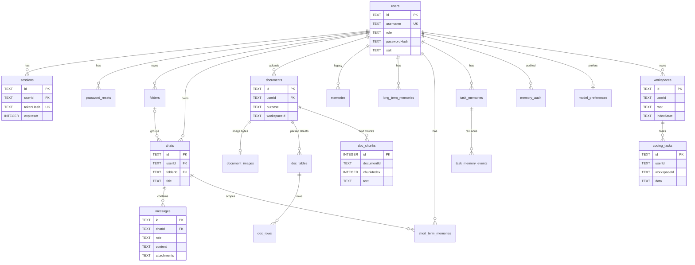

Single local SQLite file (`APP_DATA_PATH/storage/db.sqlite`, WAL mode, foreign keys on) holding accounts, sessions, chat history, document metadata and full-text indexes, memory tiers, workspaces, coding-task state and model preferences.

**Status:** Implemented. Base schema in `backend/src/db/schema.sql`; additive migrations in `db/documentMigrations.js`, `memory/migrations.js`; module-owned tables created on import by `docqa/structuredStore.js`, `coding/CodingTaskRepository.js`, `services/workspaceService.js`, `services/modelRegistry.js`, `services/modelRouter.js`.

Note: `chunks` and `usage_log` are declared in `schema.sql` but **no code reads or writes them** (legacy / unverified). Document chunks actually live in `doc_chunks` (+ FTS5) and in LanceDB.

## Responsibilities
- Identity: `users`, `sessions` (SHA-256 token hashes, 7-day sliding expiry), `password_resets`
- Conversations: `chats`, `messages`, `folders`
- Documents: `documents` (+ `purpose`, `conversationId`, `workspaceId`, `metadata`), `document_images`, `doc_tables`, `doc_rows` + `doc_rows_fts`, `doc_chunks` + `doc_chunks_fts`
- Memory: legacy `memories`; typed `short_term_memories`, `task_memories`, `task_memory_events`, `long_term_memories`, `system_memories`, `memory_audit`
- Coding: `coding_tasks`, `coding_grants`, `coding_execution_grants`, `coding_tool_approvals`, `coding_audit`; `workspaces`
- Models: `model_preferences`, `model_registry_snapshot`

## ER diagram (core relationships)

Relationship caveat: `doc_tables`, `doc_rows`, `doc_chunks`, `workspaces` and the `coding_*` tables reference their parents by id columns **without** declared `FOREIGN KEY` constraints; cleanup is done in application code.

## Tech Stack
- SQLite via better-sqlite3 13 (synchronous), FTS5 virtual tables (`unicode61` tokenizer)
