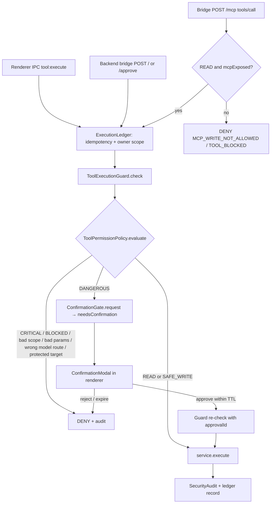

The permission layer every desktop tool request passes through: it classifies the tool's risk, checks who is asking and over which transport, validates parameters and paths, and returns ALLOW, REQUIRE_APPROVAL or DENY — with MCP access limited to a fixed set of read-only tools.

**Status:** Implemented. The read-only MCP server is **implemented but has no in-repo client** (the backend never calls `/mcp`) — **unverified** as a used feature.

## Responsibilities
- `security/ToolRegistry.js` (`createToolRegistry`): every `tool.action` gets a risk tier — `READ`, `SAFE_WRITE`, `DANGEROUS` (needs approval), `CRITICAL` (always denied) — plus `allowedScopes` (`backend`, `renderer`), parameter schema, timeout, `transport` (`BLOCKED` for CRITICAL, `file.open`, `file.writeFile`, `registry.setValue`) and `mcpExposed`
- `security/ToolPermissionPolicy.js` (`evaluate`): ordered checks — request shape → known tool → MCP must be READ + exposed → CRITICAL/BLOCKED deny → authenticated scope (`backend:<id>` / `renderer:<id>`) + taskId → params schema → model-originated calls only on the `windows` route → path policy for `file.*` → protected services (Defender, firewall, Windows Update, EventLog…) → registry only under `HKCU\Software\Chanakya` → model capability policy → capability available → DANGEROUS ⇒ `REQUIRE_APPROVAL`
- `security/ToolExecutionGuard.js` (`check`): runs the policy, validates an approval id against `ConfirmationGate.validateApproval`, records to `SecurityAudit`
- `security/PathPolicy.js`, `ToolRequestValidator.js`, `ModelRouteAuthority.js` (verifies the backend-signed Windows route proposal), `SecurityAudit.js`
- `security/ReadOnlyMcpServer.js`: JSON-RPC 2.0 (`initialize`, `ping`, `tools/list`, `tools/call`; protocol `2025-03-26`) exposing 15 read tools (hardware info, `process.list`, `services.list/getStatus`, `network.ipConfig/ping/netstat`, `file.readFile/listDir/fileInfo/searchFiles`)
- `../ConfirmationGate.js`: approval records bound to the exact request, 60 s TTL, renewable; `../DurableConfirmationStore.js` persists them

## Windows tool & MCP permission flow

## Tech Stack
- Plain Node.js, JSON-schema-like parameter validation, no external security library
