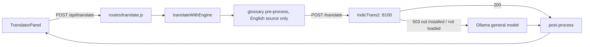

Backend client that translates text between English and Indian languages, preferring the local IndicTrans2 service and transparently falling back to a local Ollama model when that service isn't installed or running.

**Status:** Implemented (IndicTrans2 path requires the optional translator pack; Ollama fallback always available when Ollama runs)

## Responsibilities
- `translateText` / `translateWithEngine` in `backend/src/services/translationService.js`; validates the pair with `services/languageRegistry.js`
- Calls `POST {INDICTRANS_SERVICE_URL}/translate`; on HTTP 503 (service down / model missing) logs and switches `engine` to `ollama` using `resolveGeneralModel`
- Applies a small static glossary to English source text before translation (`services/glossary.js`, an extension point, not a user-editable database) and post-processing after (`services/translationPostProcess.js`)
- Exposed as `POST /api/translate` (`routes/translate.js`, `requireAuth` + `translateLimiter`), used by `frontend/src/translator/TranslatorPanel.jsx`
- Lifecycle of the Python process handled by `services/indictransProcess.js` (`ensureIndicTransRunning`, `stopOwnedIndicTrans`)

## Translation flow

## Tech Stack
- Node `fetch` via `services/inferenceTransport.js`, shared `inferenceGate`
