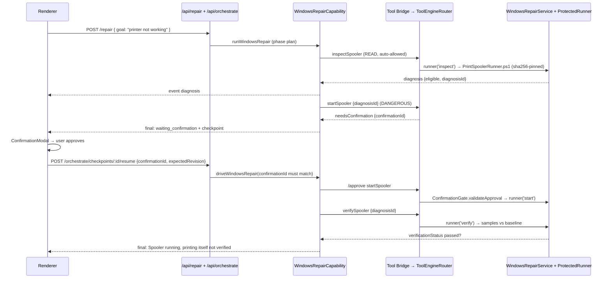

Fixes Windows problems with typed, contract-bound capabilities instead of model-written shell commands: it can start and verify the Print Spooler service after explicit user approval, and runs fixed read-only diagnostics for network, Bluetooth, audio and general system issues.

**Status:**
- Print Spooler repair (`windows.printSpooler.start.v1`) — **Implemented** end-to-end (diagnose → approve → start → verify)
- Network / Bluetooth / audio / system — **Partially implemented**: diagnostics only (`scope: 'diagnostics_only'`), the model may summarize evidence but cannot authorize any OS change
- Generic model-generated PowerShell (`agent/agentLoop.js` → `LegacyExecutionAdapter`) — **Retired**: production calls stop with `MODEL_CAPABILITY_DENIED`; `agent/powershellRunner.js` and `dangerClassifier.js` remain only for injected test fixtures
- Other repair domains in `docs/WINDOWS_REPAIR_CAPABILITY_DESIGN.md` — **Planned**

## Responsibilities
- Entry: `POST /api/repair` (`routes/repair.js`) → `ai/Orchestrator.js` `runRepair` → `orchestrator/RepairTask.js` `repairTask(goal)` picks the domain
- Spooler path: `orchestrator/WindowsRepairCapability.js` (`runWindowsRepair`, `driveWindowsRepair`) with limits from `WindowsRepairContract.js` (max 6 steps, **0 mutation retries**, 3 confirmation renewals, 35 s start, 15 s verify)
- Diagnostic path: `orchestrator/DiagnosticRepair.js` (`diagnosticPlan`, `runDiagnosticRepair`)
- Steps execute through `orchestrator/AgentExecutor.js` → `ToolEngineBridge.callTool` (`/approve` when a confirmation id is attached)
- Every run is logged by `ai/RepairLogger.js` (sessions + feedback; Admin can export the dataset)

## Diagnosis → permission → execution → verification

## Tech Stack
- Node.js, JSON checkpoints (`storage/agent-checkpoints`), PowerShell runner on the Electron side
