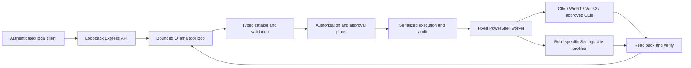

# Local Windows OS agent

A standalone Node.js/Express ES-module server for Ollama tool calling, with a typed Windows automation catalog, PowerShell 5.1 workers, WinRT radio control, Core Audio, display APIs, and a constrained UI Automation fallback.

**This is a runnable implementation, not a claim that every Windows setting has a universal API or that this package is production-certified.** Windows build, edition, hardware, drivers, policy, language and interactive-session permissions affect support. Direct read adapters were exercised on Windows 11 build 26200. Mutation paths and Windows 10 compatibility require acceptance testing on your deployment machines. UIA requires locally calibrated profiles; none are represented as universally valid.

This package is isolated from the existing chatbot application. It does not modify its server, frontend, existing agent or credentials.

## Run

Requirements: Windows 10/11 x64, Node.js 22.15+ (tested with 24.18), Windows PowerShell 5.1, Ollama with a tool-capable Qwen model already installed. For UIA, run in the signed-in user's desktop session. Session 0 services cannot control the interactive desktop.

```powershell
Set-Location E:\chatbot\windows-os-agent
npm ci
Copy-Item .env.example .env
npm run token
```

Put the generated secret in `.env` as `AGENT_TOKEN`, then:

```powershell
npm start
```

In another terminal, in the same directory:

```powershell
npm run ask -- "What are my current audio devices and volume?"
npm run ask -- "Set the master volume to 30 percent" --changes
npm run ask -- "Disable the Public firewall profile" --changes
# For a returned approval plan, inspect its exact operation, parameters and before-state:
npm run ask -- approve PLAN_UUID
# Reuse a conversation:
npm run ask -- "Now mute it" --changes --session SESSION_UUID
```

The example firewall request creates a reviewable plan; it does not execute until the trusted client approves it. Plans expire after two minutes. To require plans for low-risk operations too, set `AUTO_APPLY_LOW_RISK=false`.

The installed model tag is configurable with `OLLAMA_MODEL`; this machine has `qwen3.5:9b`. The service does not download models, install software or silently elevate itself.

`OLLAMA_THINK=false` is the default for lower tool-call latency. On this machine, a live read-only tool loop succeeded with reasoning disabled after the initial reasoning-enabled request exceeded its two-minute deadline. Adjust `OLLAMA_TIMEOUT_MS` for your hardware (up to 300,000 ms per call).

The October 2 CPU-only validation took about 143 seconds for the complete model/tool/model exchange. Direct Windows adapters complete much faster, but model inference determines conversational latency. This is not a demonstrated real-time Astra-like experience on this hardware.

For administrator-only operations, start the server from a terminal explicitly launched as Administrator under the **same Windows user**. Running it under a different admin account changes HKCU and the target desktop. `system.inspect` reports elevation and session identity. UAC, access denials and managed-device policies are never bypassed.

## Architecture



The `/api/chat` integration sends native Ollama `tools`, appends the complete assistant message including `tool_calls`/`thinking`, executes calls sequentially, then sends `role: "tool"`, `tool_name`, and JSON content back to the model. This bounded iterative loop implements multi-turn tool execution without an unbounded JavaScript recursion stack. Tool/step/context limits, cancellation and deadlines bound work.

The model receives two tools: `list_capabilities` and `run_operation`. Discovery returns exact per-operation schemas. Every operation is revalidated by the server with Ajv: unknown properties, wrong types, invalid IP addresses, out-of-range values and unknown operations are rejected. The model never receives a shell execution tool, an approval tool or a mechanism to edit the trusted catalog.

## Coverage and limits

| Area | Implemented mechanisms | Deployment limits |
|---|---|---|
| Wi-Fi, Bluetooth, cellular radios | WinRT enumeration and state changes; saved WLAN profile connection through `netsh` | Hardware/driver dependent; radio access can require user consent. Wi-Fi connection completion is reported unverified because the CLI output is localized. No password extraction or profile creation. |
| Airplane mode | Actual Settings switch via UIA | Requires a calibrated selector. Disabling adapters is not called Airplane mode. |
| Ethernet, DNS, IPv4 | NetAdapter, DnsClient and NetTCPIP cmdlets; per-interface verification | Administrator; approved changes may disconnect networking. Static IPv4 replaces manual addresses on that adapter. DNS reset is reported unverified because reading server addresses does not prove DHCP source. IPv6 addresses are not configured by this package. |
| Brightness | `WmiMonitorBrightness` / `WmiSetBrightness`; optional UIA fallback | Internal/laptop panels; external DDC/CI support is not implemented. |
| Resolution and refresh | Enumerate driver modes, test, then `ChangeDisplaySettingsEx` | Active displays and enumerated integer-Hz modes only; fractional refresh and HDR controls are not covered. No automatic timed display rollback. |
| Multiple monitors | QueryDisplayConfig / SetDisplayConfig | Internal, clone, extend, external topologies; arbitrary monitor coordinates/scaling are not exposed. |
| Night light | Settings UIA | Requires a matching build/language profile; no reverse-engineered CloudStore writes. |
| Audio | Core Audio enumeration, master volume and mute; UIA default endpoint selection with native readback | Default endpoint selection needs a calibrated profile and matching endpoint name. No undocumented IPolicyConfig dependency. |
| Power | `powercfg` plans, AC/DC display/sleep/hibernate timeouts, hibernate enablement; native battery status | Some plans/timeouts are unavailable on Modern Standby systems. Battery/energy saver mutation uses UIA. |
| Personalization | Light/dark preferences, wallpaper via SystemParametersInfo, taskbar auto-hide via Shell API | Theme verification proves persisted preferences; individual apps may require restart. Other taskbar behaviors are not exposed. Accent-color UI text entry is not claimed as a fully applied color. |
| Privacy | Current-account location/camera/mic consent and relevant policy observations | ConsentStore values are Windows implementation details. Verification proves stored consent, not every app's effective access. Machine/per-app policy may override it. |
| Firewall | Read and set Domain/Private/Public profiles | Administrator and explicit approval required for changes. |
| Storage | Volume status and bounded temp-file cleanup with a candidate preview | Current-user temp only, aged files only, no recursive directory deletion, no reparse traversal. Not a general disk-cleanup or uninstall tool. |
| Updates | WUA history, reboot state, applicable-update scan; open update installation UI | Scan may contact the configured update service. Installation remains user-supervised; no forced reboot or automatic EULA acceptance. |
| Services | Exact service inspection; allowlisted start/stop/restart/startup changes | Default mutation allowlist: Spooler and WSearch. No force-stop of dependencies. |
| Registry | Named HKCU/HKLM targets with specific value types and ranges | No arbitrary paths or deletion. Extend `config/policy.json` after review; model cannot add targets. |
| Local Group Policy | `gpresult`, `gpupdate`; allowlisted Local GPO DWORD edits with Microsoft LGPO | LGPO must be installed and pinned by path/hash. `gpupdate` alone is not a policy editor. Domain policy can override Local GPO. |
| Settings navigation | Fixed allowlist of `ms-settings:` pages | Opening a page is reported as navigation, never a successful setting change. |

`GET /capabilities` is the source of truth for the catalog and schemas. Missing capabilities return structured errors instead of fabricated success.

## Verification and error semantics

Writes read relevant state before execution, perform one mutation, then read back and verify the requested value. Verification is retried up to four times without repeating the mutation. Responses include `before`, `after`, `effect` and `verified`.

* `verified`: the adapter's stated postcondition was observed; read each capability's scope above.
* `executed_unverified`: the command returned, but the effective setting was not proven.
* `approval_required`: a plan exists; its mutation has not executed.
* `manual_action_required` / `opened`: navigation completed; user work remains.
* `ADMIN_REQUIRED`, `ACCESS_DENIED`, `POLICY_DENIED`, `UIA_PROFILE_REQUIRED`, `UNSUPPORTED_HARDWARE`: actionable limitations.
* `VERIFICATION_FAILED`, timeout or malformed worker output after execution: outcome may be partial/unknown. Further writes are persistently blocked until the operator stops the server/workers, inspects state, records recovery and restarts the server.

The `before` state is evidence, not a universal rollback script. Networking, display changes, service restarts and policy refreshes may have effects that cannot safely be undone automatically. Test these on a disposable machine with local recovery access before deployment.

## Approval and API contract

Every endpoint requires `Authorization: Bearer <AGENT_TOKEN>`. Bind address is fixed to `127.0.0.1`. Browser Origin requests and unrecognized Host headers are rejected; no CORS or cookie auth is enabled. Use a trusted desktop client or server-side bridge. Do not ship the bearer secret into a web frontend.

| Method | Route | Purpose |
|---|---|---|
| GET | `/health` | Service configuration; not an Ollama health guarantee |
| GET | `/capabilities` | Operation definitions and input schemas |
| GET | `/requests/:id` | Durable request status after a disconnect or service restart |
| POST | `/sessions` | Create server-owned conversation; body `{}` |
| POST | `/chat` | `{sessionId, requestId, message, allowChanges}`; UUID IDs, no caller-supplied system/history messages |
| GET | `/plans/:id` | Review exact parameters, before-state, expiry and risk description |
| POST | `/plans/:id/approve` | `{sessionId, approve:true}` from the trusted client; not available as a model tool |

Default requests are read-only. `allowChanges:true` authorizes low-risk catalog changes. High-risk writes always create exact, expiring, session-bound, one-use plans. Approval rechecks current state and rejects stale plans, and the worker checks that state again immediately before attempting the mutation. This is an optimistic check, not an OS-wide transaction: an external program can still change state concurrently.

Repeated request IDs are rejected across process restarts. `var/journal.jsonl` stores request IDs/body hashes and mutation start/finish records, flushed before execution. Sessions, chat text, completed response bodies and unexecuted plans remain in memory and expire at restart. A duplicate response returns its persisted status if the full result is no longer available; never silently resubmit an uncertain change with a new ID.

If the journal contains an interrupted or unknown mutation, `/health` reports `writesBlocked` and its execution UUID. Read operations remain available. Stop the server and any surviving worker, inspect the affected setting, then run `npm run recover -- EXECUTION_UUID`. This local command requires an explicit operator acknowledgment; no LLM tool can clear the latch. Restart alone does not clear it. Malformed/truncated journals fail startup and require operator inspection rather than silent data loss.

An OS-managed named-pipe listener prevents a second server or recovery process from using the same data directory. No stale lock file is left after process exit. Run the supplied entrypoint, or call `acquireInstance` when embedding `createApp` in another application.

Resource bounds: 100 sessions, 100 pending plans, 10,000 cached response bodies per process lifetime, 100,000 durable request IDs, four active requests, globally serialized workers, 32 KiB HTTP request bodies, 1 MiB worker/model messages, default 12 model rounds and at most eight calls per round. The journal refuses startup or further appends above 128 MiB. Retention/archival must preserve your required replay protection. There is no background autonomous scheduler.

## UI Automation calibration

UIA is disabled by default. Set `ENABLE_UIA=true` only for an interactive desktop deployment. Primary API absence may trigger UIA only for recognized `UNSUPPORTED_HARDWARE` / `API_UNAVAILABLE` errors, never on access denial or after a possible partial mutation.

The trusted operator can observe a Settings page with:

```powershell
powershell.exe -NoProfile -File scripts\Inspect-Settings.ps1 -Page display
```

This opens Settings and reports AutomationIds, names, control types and available patterns without changing controls. Place a reviewed selector in `config/uia-profiles.json`:

```json
{
  "profiles": [{
    "operation": "nightlight.set",
    "build": "YOUR_EXACT_WINDOWS_BUILD",
    "culture": "en-US",
    "uri": "display",
    "automationId": "EXACT_ID_FROM_INSPECTION",
    "controlType": 50002,
    "pattern": "toggle"
  }]
}
```

The above is a **format example, not a working selector**. Use the returned control type, not the example number. Supported patterns are toggle, range, selection and value. Optional exact `name` further narrows matching; `{name}` can bind a returned audio endpoint name. Optional `when`, such as `{"direction":"output"}`, selects separate input/output profiles. Profile selection requires exact build and UI culture. `.get` uses the corresponding `.set` selector.

The worker accepts exactly one visible, enabled matching control belonging to SystemSettings in the current session. Ambiguity, hidden/disabled controls, tri-state ambiguity and missing profiles fail closed. There are no arbitrary coordinates, keystrokes or generic InvokePattern actions. Multi-step settings dialogs such as custom accent colors may still require manual application; matching a text field does not prove the color was applied. Recalibrate profiles after relevant Windows updates and test them on the target locale.

## Local GPO support

Obtain Microsoft LGPO from the official Security Compliance Toolkit. Set `lgpo.path` and `lgpo.sha256` in `config/policy.json`; the worker checks SHA-256 and a valid Microsoft Authenticode signature before invocation. The default allowlisted example is the current-user policy for toast notifications. Edits import one exact DWORD setting using LGPO text format, refresh policy, then verify both Registry.pol and the effective value. Policy deletion and arbitrary policy imports are not exposed.

## Security and deployment boundary

This is an **application allowlist, not an OS security sandbox**. A denylist for words such as `format` would not secure an arbitrary PowerShell tool. Here, model-controlled text is JSON on stdin to fixed scripts; it is never a command body. Native binaries use fixed executable paths and structured arguments. No `Invoke-Expression`, `cmd /c`, model-supplied script, unrestricted registry operation or process-launch tool exists.

PowerShell execution policy is honored. If your organization requires signed scripts, sign/deploy these scripts through that policy; the service does not set `ExecutionPolicy Bypass`. The worker receives a reduced environment that excludes the API token. Timeouts kill the worker process tree, but Windows operations already committed can outlive their initiating process. Cancellation is not rollback.

For production, protect the package, scripts, policy files, secrets and audit directory with Windows ACLs. Node's POSIX `mode:0600` does not establish Windows ACL isolation. An attacker able to modify these trusted files, inject into this process or read the same user's token is outside this boundary. The current design optionally elevates the entire operator-started server; a hardened multi-user deployment should split off a signed, narrowly privileged broker with authenticated named-pipe IPC and restrictive ACLs. This package does not implement that broker or an AppContainer.

The server's `var/journal.jsonl` contains operation IDs, request/session/plan IDs, parameter hashes and outcomes, not the bearer token or full chat transcripts. A failed pre-execution journal write blocks mutations. When embedding `Executor` without a Journal, its legacy fallback logger writes `var/audit.jsonl`; use the supplied Journal for restart protection. Plan responses and tool results can contain local paths and network configuration; treat them as private. Journal retention/rotation, service packaging, full incident recovery and multi-user authorization remain deployment work.

## Tests and files

```powershell
npm test
npm run check:windows
npm run smoke
npm run smoke:ollama
```

`npm test` uses simulated adapters to check validation, policy enforcement, approvals, stale state, restart/replay protection, serialization, journal failures, single-instance ownership, HTTP protections, native Ollama message sequencing, Unicode worker output and timeouts. `check:windows` parses every PowerShell script, compiles C# and runs 27 synthetic postcondition/state-comparison checks without executing settings changes. `smoke` exercises only direct read operations and writes a redacted report to `var/smoke-results.json`.

No mutation acceptance tests run automatically. Verify changes, restoration behavior, policy inheritance and UI profiles in disposable Windows 10/11 VMs and on each supported hardware family before calling a deployment production-ready.

| File | Responsibility |
|---|---|
| `src/server.mjs` | Express API, auth, sessions, request limits and approvals |
| `src/agent.mjs` | Ollama protocol, iterative execution loop and conversation state |
| `src/catalog.mjs` | Tool definitions, operation schemas and risk metadata |
| `src/executor.mjs` | Policy, plans, serialization, audit and fallback selection |
| `src/journal.mjs`, `instance.mjs`, `recover.mjs` | Flushed request/mutation journal, exclusive process ownership and operator recovery |
| `src/runner.mjs` | Fixed worker launch, JSON I/O, timeouts and cancellation |
| `src/prompt.mjs` | Qwen system instructions |
| `scripts/Dispatch.ps1` | Observe/apply/verify orchestration and JSON errors |
| `scripts/Queries.ps1`, `Mutations.ps1` | Modular Windows setting adapters |
| `scripts/Native.cs` | Core Audio, display, power and shell interop |
| `scripts/Radio.ps1`, `GroupPolicy.ps1`, `UIA.ps1` | Specialized adapters |
| `config/policy.json`, `uia-profiles.json` | Trusted deployment allowlists and selectors |

`config/operations.json` mirrors catalog risk metadata for the worker; the test suite rejects drift. When extending the catalog, regenerate this file and add schema, precondition, readback and failure tests before adding a new mutation.

To integrate with the existing chatbot, call this service from the trusted Node backend or Electron main process. Keep `AGENT_TOKEN` there, retain the returned session UUID, show the returned approval plan in your trusted UI, and submit approval only after a user action. Do not place the bearer token in browser JavaScript or turn model-generated text into approval requests. The existing Settings-page launcher is not changed by this package.

## Primary references

* [Ollama tool calling and multi-turn message protocol](https://docs.ollama.com/capabilities/tool-calling)
* [Microsoft Settings URI catalog](https://learn.microsoft.com/en-us/windows/apps/develop/launch/launch-settings)
* [Microsoft WmiSetBrightness](https://learn.microsoft.com/en-us/windows/win32/wmicoreprov/wmisetbrightness-method-in-class-wmimonitorbrightnessmethods)
* [Microsoft ChangeDisplaySettingsEx](https://learn.microsoft.com/en-us/windows/win32/api/winuser/nf-winuser-changedisplaysettingsexw)
* [Microsoft EndpointVolume API](https://learn.microsoft.com/en-us/windows/win32/coreaudio/endpointvolume-api)
* [Microsoft Windows Update Agent API](https://learn.microsoft.com/en-us/windows/win32/wua_sdk/using-the-windows-update-agent-api)
* [Microsoft Security Compliance Toolkit](https://learn.microsoft.com/en-us/windows/security/operating-system-security/device-management/windows-security-configuration-framework/security-compliance-toolkit-10)
